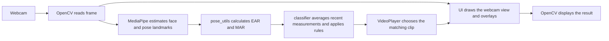

# How the Application Works

This guide explains how the webcam application is connected, what happens to each frame, and where machine learning is used. It assumes no previous computer vision or machine learning experience.

## The Short Version

The application repeatedly reads an image from a webcam, asks MediaPipe to locate landmarks on a face and body, measures how open the eyes and mouth appear, and applies a few hand-written rules to choose a video clip. It then draws information and the selected clip on top of the webcam image.

There is machine learning inside MediaPipe's pretrained landmark detectors. The expression classifier in this project is not a trained machine-learning model: it uses fixed thresholds written in Python.

## How the Pieces Connect



The main loop lives in [src/app.py](src/app.py). It creates each component, passes data between them, and repeats the work until you quit.

## What Happens At Startup

1. `app.py` builds paths to the clips in `data/videos/` and warns if a clip file is missing.
2. It searches for a working camera. The current setting calls `_find_working_cam(0)`, so it only tries camera index `0`. Camera indices depend on the computer and do not identify a camera by its name.
3. It creates a `MediaPipeCapture` to read webcam frames and run MediaPipe.
4. It creates an `ExpressionClassifier` to interpret facial measurements.
5. It creates a `VideoPlayer` and maps each expression label to a video path.
6. It creates a `UIManager`, which draws and displays the combined result.

## What Happens For Each Frame

The program processes one frame at a time in a loop:

1. **Read an image.** `MediaPipeCapture.read()` asks OpenCV for the next webcam frame. A frame is just one still image from the camera stream.
2. **Prepare it for MediaPipe.** OpenCV represents color channels as BGR (blue, green, red). The capture code converts the image to RGB (red, green, blue), the format expected by these MediaPipe APIs. It keeps the original BGR frame for later display.
3. **Find landmarks.** MediaPipe estimates face landmarks and pose landmarks from the RGB image.
4. **Measure the face.** `pose_utils.py` converts the face landmark positions to pixel coordinates and calculates eye and mouth ratios.
5. **Choose a label.** The classifier averages recent measurements and applies rules to select `messi_yell`, `mom_homeless_laugh`, or `neutral`.
6. **Choose a clip.** The video player switches to the clip associated with a non-neutral label. A neutral label does not stop or replace the last active clip.
7. **Draw and display.** The UI draws selected facial points, the expression label, optional metrics, and the video panel on the webcam frame. OpenCV displays the completed image in a window.

If the camera cannot provide a frame, `app.py` exits its main loop and cleans up the camera, video, and window resources.

## Computer Vision And Landmarks

**Computer vision** means using software to extract useful information from images or video. Here, the useful information is the estimated location of features on a person's face and body.

A **landmark** is a point with a position. For example, a face landmark can correspond to an eye corner or lip point. MediaPipe returns normalized coordinates for these points: `x` and `y` are generally fractions of the image dimensions rather than pixel numbers. For example, `x = 0.5` is around the horizontal center of the image. The capture code also receives a `z` value from MediaPipe.

`pose_utils.landmarks_to_np()` converts `x` and `y` into pixel coordinates by multiplying by image width and height. This makes it possible to measure distances and draw points on the image. The calculations use NumPy arrays, which are a convenient way to perform numeric operations on groups of coordinates.

The capture code runs two MediaPipe components:

- **Pose** estimates body landmarks. This project currently computes these landmarks but does not use them to classify expressions. The upper-body metrics function returns `None`, and the UI's pose skeleton drawing method is disabled.
- **Face Mesh** estimates detailed facial landmarks. The code uses these landmarks for eye and mouth measurements and draws a sparse selection of them as points on the output image. It does not draw the full mesh connections.

## Where The Machine Learning Is

MediaPipe's pose and face landmark detectors are machine-learning models. The models were trained before this application was written, and the application uses them to make predictions about landmark locations in each frame. This act of using an already-trained model is called **inference**.

This repository does not train those models. It does not include a dataset of labeled expressions, a training loop, or a project-specific learned classifier. No model is updated from your webcam footage.

The expression decision is instead **rule-based** Python code. It calculates ratios and compares them with thresholds chosen by the developer. That is useful for a small, transparent project, but it means the app does not learn what a yell or laugh looks like from examples. The thresholds may need adjustment for different faces, camera positions, or lighting.

In short:

- **Machine learning:** MediaPipe estimates where facial and pose landmarks are.
- **Geometry/math:** The project calculates ratios from the facial landmark coordinates.
- **Hand-written rules:** The project maps those ratios to expression labels.
- **No project training:** There is no training of an expression-recognition model in this codebase.

## Facial Measurements

The calculations are in [src/pose_utils.py](src/pose_utils.py). The landmark index lists identify which MediaPipe points to use around the eyes and mouth.

### EAR: Eye Aspect Ratio

EAR stands for **Eye Aspect Ratio**. The code measures two vertical gaps between eyelid points and compares their average with the eye's horizontal width:

```text
EAR = (vertical_gap_1 + vertical_gap_2) / (2 * eye_width)
```

When the eye closes, its vertical gaps tend to shrink while its width changes less, so EAR tends to get smaller. The app averages the EAR from the left and right eyes.

### MAR: Mouth Aspect Ratio

MAR stands for **Mouth Aspect Ratio**. The code measures the vertical gap between two mouth points and divides it by the distance between the left and right mouth corners:

```text
MAR = mouth_height / mouth_width
```

When the mouth opens, the vertical gap tends to grow, so MAR tends to get larger.

These are geometric measurements, not learned classifications. They are approximate signals: head angle, face shape, landmark accuracy, and camera view can affect them.

## How The Classifier Decides

The logic is in [src/classifier.py](src/classifier.py). For each update, it:

1. Adds the current measurements and timestamp to a buffer.
2. Removes entries older than the configured `0.6` second window.
3. Averages available face EAR and MAR values in that buffer.
4. Applies the following checks in order:

```text
if average MAR > 0.45:
    label = "messi_yell"
elif average EAR < 0.20:
    label = "mom_homeless_laugh"
else:
    label = "neutral"
```

Because the mouth check comes first, a high MAR takes priority if both conditions are true at once. If no face measurements are available in the buffer, the defaults lead to a neutral label.

The classifier also uses a `0.25` second debounce. Debouncing means requiring a proposed change to persist briefly before accepting it. This helps prevent a one-frame detection fluctuation from immediately changing the label. It smooths the output; it does not train a model.

The thresholds can be adjusted in `ExpressionClassifier` in [src/classifier.py](src/classifier.py). Lowering the MAR threshold makes the mouth-open rule easier to trigger; raising it makes it harder. Raising the EAR threshold makes the eyes-closed rule easier to trigger; lowering it makes it harder.

## How The Video Clip Is Selected

In `app.py`, the labels are connected to paths in `data/videos/`:

| Label | Video file |
| --- | --- |
| `messi_yell` | `data/videos/speed_messi.mp4` |
| `mom_homeless_laugh` | `data/videos/speed_mom_homeless.mp4` |

`VideoPlayer.set_target()` opens a clip when a new non-neutral label arrives. If the label is neutral, it leaves the active clip alone. It restarts playback from the beginning after its configured three-second interval. This video playback and selection are ordinary OpenCV/Python operations, not machine learning.

## What The UI Shows

`ui.py` is responsible for the visible window. It:

- Copies the webcam frame so the original image can be retained.
- Draws a selection of eye, mouth, and nose landmark points when a face is detected.
- Writes the current expression label on the frame.
- Shows EAR and MAR values when the metrics overlay is enabled.
- Places the active video frame in the top-left corner.
- Displays the result using OpenCV.

Press `m` to toggle the metrics display and `q` to quit. The landmarks drawn are separate points; the code does not currently draw a connected face mesh or pose skeleton.

## File Responsibilities

- [src/app.py](src/app.py): Starts the application, configures video paths and camera selection, coordinates components, and runs the main loop.
- [src/capture.py](src/capture.py): Reads webcam images and calls MediaPipe for face and pose landmarks.
- [src/pose_utils.py](src/pose_utils.py): Converts landmark coordinates and calculates facial geometry measurements.
- [src/classifier.py](src/classifier.py): Averages measurements over time and applies the expression rules.
- [src/video_player.py](src/video_player.py): Opens and plays the video clip associated with a label.
- [src/ui.py](src/ui.py): Draws the overlays and presents the output window.
- [requirements.txt](requirements.txt): Lists the third-party Python packages used by the project.

## Other Libraries Involved

- **OpenCV (`cv2`)** reads webcam frames and video files, converts color formats, draws text and circles, resizes video frames, and displays the window.
- **MediaPipe** runs the pretrained landmark models.
- **NumPy** handles coordinate arrays, distances, and numeric calculations.
- **Python's standard library** handles paths, timestamps, and the classifier's rolling buffer.

## Current Limitations To Know About

- Pose landmarks are calculated but currently do not affect the expression label or appear as a skeleton in the UI.
- The classifier uses only EAR and MAR thresholds. It does not understand expression context or learn from examples.
- The label names are just strings used by this application; MediaPipe does not identify those meme categories.
- Camera index `0` is the current search limit in `app.py`. A different connected camera may require changing the index.
- The README describes some upper-body behavior that is disabled in the current implementation; the source files are the best reference for what the running app does today.

## Running The App

The project README gives the environment setup steps. Once the dependencies are installed in the selected Python environment, start the application from the project root with:

```powershell
python -m src.app
```

The `-m src.app` form runs `app.py` as part of the `src` package, which is why its imports use the relative form, such as `from .capture import MediaPipeCapture`.

## Inspecting Landmarks In A Photo

To see what MediaPipe detects in a still image, run the landmark inspection tool from the project root:

```powershell
python -m src.inspect_landmarks "path\to\your_photo.jpg"
```

It opens a window showing the face mesh, body pose skeleton, and detected hand skeletons. It saves annotated images in `data/test_images/test_annotated_image/` with `_landmarks` added to the filename, and saves hand landmark data in `data/test_images/test_json/` as `<image>_hand_landmarks.json`. For example, the face model can return 478 points when refined landmarks are enabled, pose returns 33, and each detected hand returns 21.

The JSON contains the 21 named hand landmarks, normalized image coordinates, pixel coordinates, MediaPipe's hand-centered world coordinates, handedness, and its confidence score. It also contains the 21 hand connections as pairs of landmark IDs and names, so you can reconstruct the hand skeleton from the coordinates without the annotated image. A `features` section saves joint angles and one boolean extension result for each finger. These features are calculated from the 2D image pixel coordinates, so the angles correspond to the hand as it appears in the image. A non-thumb finger is marked extended when the average of its PIP and DIP angles is at least 120 degrees; the thumb is marked extended when its MCP angle is greater than 165 degrees. The separate world coordinates are still saved for reference. The angle values and thresholds are included in the JSON. These are geometric heuristics, not a trained gesture classifier, and you may need to tune them for your camera and gesture.

You can choose the image output path with `--output "path\to\annotated.jpg"` and the JSON output path with `--landmarks-output "path\to\hand_data.json"`. To save outputs without opening a window, add `--no-display`.

To hide only the hand joint number and angle labels while keeping the landmark points and connecting lines, add `--no-joint-labels`.

Use a clear, well-lit image where your face, body, and hands are visible. A still image runs in static-image mode, so it does not require or access the webcam.

## Live Hand Gesture Demo

Run the separate live webcam demo from the project root. Choose at least one output: local preview and/or virtual camera.

```powershell
.\.venv\Scripts\python.exe -m src.live_gesture_demo --preview
```

On Windows, install OBS Studio and start its Virtual Camera from OBS once before launching the script. Then run virtual-camera-only output for calls:

```powershell
.\.venv\Scripts\python.exe -m src.live_gesture_demo --virtual-camera
```

To send the virtual camera and also show a local preview, add `--preview`. The script uses the camera's negotiated resolution for virtual output and sends unmirrored BGR frames at 30 FPS by default; change the frame rate with `--fps`. It does not flip the image in code. The call app may mirror only your self-view; other participants receive the correct orientation.

It recognizes `pointing_fist` when the thumb is extended and the index, middle, ring, and pinky fingers are not. Recognition must be stable for three frames before the status appears. Each newly recognized gesture starts `data/test_videos/diem_archive_tanner.mp4` as a one-shot overlay. The clip continues to its end if the hand pose disappears, stays hidden before a trigger and after playback completes, and can be triggered again after the gesture is released and recognized again. Press `q` in a preview window to quit; without preview, press Ctrl+C in the terminal. If the desired webcam is not camera index 0, choose an index explicitly, for example `--camera 1`.

In Zoom, select **OBS Virtual Camera** under Settings > Video > Camera. For WhatsApp, use its desktop camera picker if available; otherwise use WhatsApp Web in a browser with a camera picker or set the virtual camera as the system default. The virtual camera sends video only, not the overlay clip's audio.

This live path passes the current per-frame `finger_extended` dictionary directly to the gesture recognizer; it does not write or read JSON. The photo inspector continues saving JSON for offline inspection and examples.